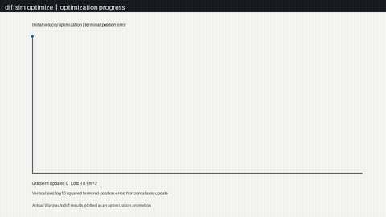
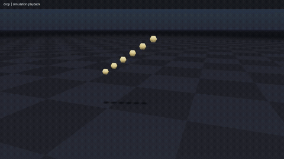

<!-- Generated by tools/build_readme.py; edit pyproject.toml and the sources in docs/. -->
# newton-solver

A differentiable external Newton solver starter.

## Build from a paper with Codex or Claude Code

Open this repository in Codex or Claude Code and provide the paper (URL, DOI or local PDF) and the examples you want. The bundled `paper-to-newton-solver` skill handles setup, implementation, numerical checks, paper-to-code links and example recordings. No global skill installation or sibling solver checkout is needed.

```text
Use paper-to-newton-solver.
Paper: <URL, DOI or local PDF>
Examples to achieve: <describe the scenes and expected behavior>
Package name: newton-solver-my-method
```

Add reference code/assets, resolution, target hardware/frame rate and differentiated inputs when they matter. The agent should ask only for missing information that blocks the work. A paper and examples guide the implementation; correctness and real-time performance must be established by tests and measurements.

One [skill](.claude/skills/paper-to-newton-solver/SKILL.md) is shared by both tools: Claude Code reads `.claude/skills/`, and Codex follows the relative symlink in `.agents/skills/`. [CLAUDE.md](CLAUDE.md) imports the common [AGENTS.md](AGENTS.md). These locations follow the [Codex](https://developers.openai.com/codex/skills) and [Claude Code](https://code.claude.com/docs/en/skills) skill conventions.

Clone your template Git repository into the new solver's directory and open it in your agent:

```bash
git clone <template-git-url> newton-solver-my-method
cd newton-solver-my-method
```

The agent initializes this clone in place. To do that step yourself (Python 3.12):

```bash
python3 tools/new_solver.py --in-place --name newton-solver-my-method
```

Setup renames the package, solver class and lockfile, preserves Git history, and removes the setup script and inherited demo videos. It leaves two small runnable examples to replace with your requested demonstrations. To create a separate directory instead, use `python3 tools/new_solver.py ../newton-solver-my-method --name newton-solver-my-method`.

## Run

From this directory:

```bash
./docker/build.sh
./docker/run.sh                 # Choose an automatically discovered example.
./docker/run.sh --list          # List examples without Docker or GPU access.
./docker/run.sh <example>       # Run one example.
```

For local development:

```bash
uv sync --locked --extra examples
uv run --locked python -m newton_solver.examples
```

Linux x86-64 or ARM64; host launchers need Python 3.11+, local development uses Python 3.12. CUDA runs need an NVIDIA driver compatible with the locked CUDA 13 Warp wheel; Docker GPU runs also need NVIDIA Container Toolkit. Use `--cpu --headless` before the example name for supported CPU scenes. Visual Docker runs use the local X11 display and a readable `XAUTHORITY` file. Use `./docker/run.sh --headless -- COMMAND ...` for a terminal container command. Source is mounted from this directory; rebuild after changing dependencies.

## Dependencies

Installed runtime packages: `newton==1.7.0`, `warp-lang==1.17.0`, `numpy>=2,<3`. No sibling solver package or external source checkout is required. The `examples` extra supplies the viewer and any USD/robot dependencies; `uv.lock` fixes their versions. Example-specific data requirements are listed below.

## Mathematical method

This is a particle integrator starter, not an implementation of a particular
research paper. A generated solver must replace this section with its own
method and primary references.

For particle position $x_n$, velocity $v_n$, mass $m>0$, force $f_n$ and
timestep $h$, the semi-implicit Euler update is

$$
v_{n+1}=v_n+h(g+f_n/m),\qquad x_{n+1}=x_n+h v_{n+1}.
$$

With a horizontal plane, an intersecting particle is projected to the plane
plus its radius; an incoming normal velocity is multiplied by $-e$, where
$e\in[0,1]$ is restitution. The implemented branch is differentiated using
Warp's reverse mode over distinct saved states. Initial state and applied
forces may be differentiated; mass, timestep, plane position and restitution
are fixed. Contact creation and branch switching are nonsmooth.

## Papers

No paper reproduction is claimed for this starter. The implementation uses
the public [Newton SolverBase interface](https://newton-physics.github.io/newton/1.7.0/api/_generated/newton.solvers.SolverBase.html).
Add the implemented paper's DOI or author-hosted manuscript when replacing
the starter method.

## Examples

One demonstration clip per example. Click a preview to open its MP4. Videos show simulated motion rendered offline; playback rate is not a performance measurement.

| Example | Example |
| --- | --- |
| **[diffsim_optimize](src/newton_solver/examples/example_diffsim_optimize.py)**<br>Fit initial velocity with Warp autodiff through a small free-flight rollout.<br><a href="docs/media/diffsim_optimize.mp4"></a><br>Measured terminal-position loss over initial-velocity gradient updates.<br>`./docker/run.sh diffsim_optimize` | **[drop](src/newton_solver/examples/example_drop.py)**<br>Particles bouncing on a package-owned plane collider.<br><a href="docs/media/drop.mp4"></a><br>Particle drops and restitution against a plane.<br>`./docker/run.sh drop` |

## Regenerate documentation

```bash
python3 tools/build_readme.py
python3 tools/build_readme.py --check
uv run --locked python tools/record_examples.py --all
python3 tools/build_readme.py --require-videos
```

README generation uses only Python's standard library and discovers examples from their launcher. Recording needs the `examples` extra, `ffmpeg`, and OpenGL. `docs/videos.json` stores optional capture arguments; it does not define the example list. `tools/video_scenarios.py`, when present, scripts interactions for recording. Each clip has a metadata file recording arguments, frame count and capture conditions.

## Validate

```bash
uv run --locked ruff check .
uv run --locked ruff format --check .
uv run --locked python -m unittest discover -s tests -v
NEWTON_TEST_DEVICE=cuda:0 uv run --locked python -m unittest discover -s tests -v
uv build
```

License: [Apache-2.0](LICENSE).
